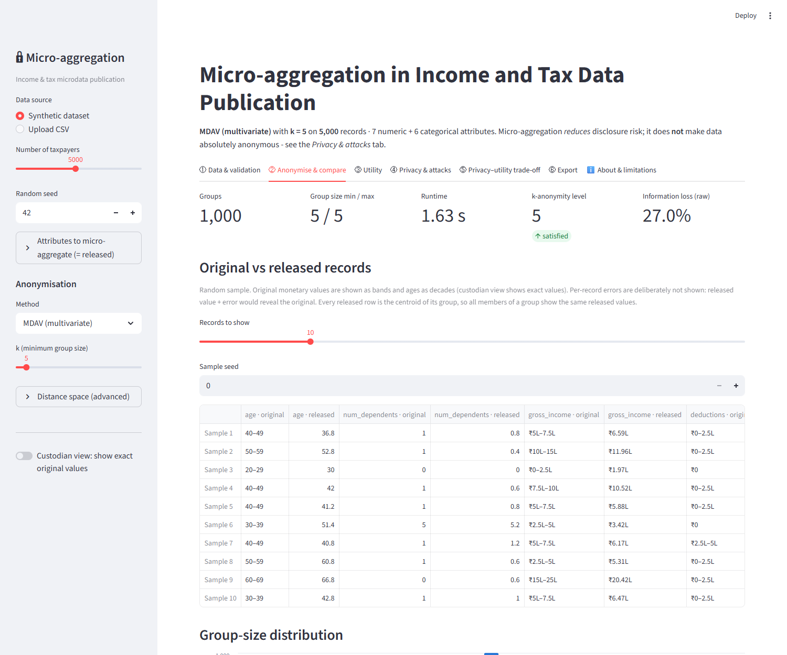
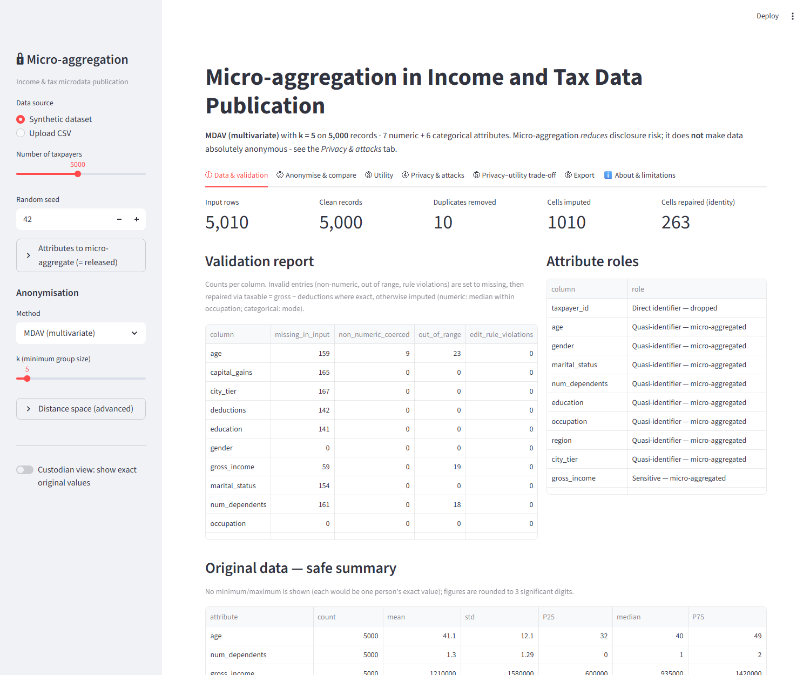
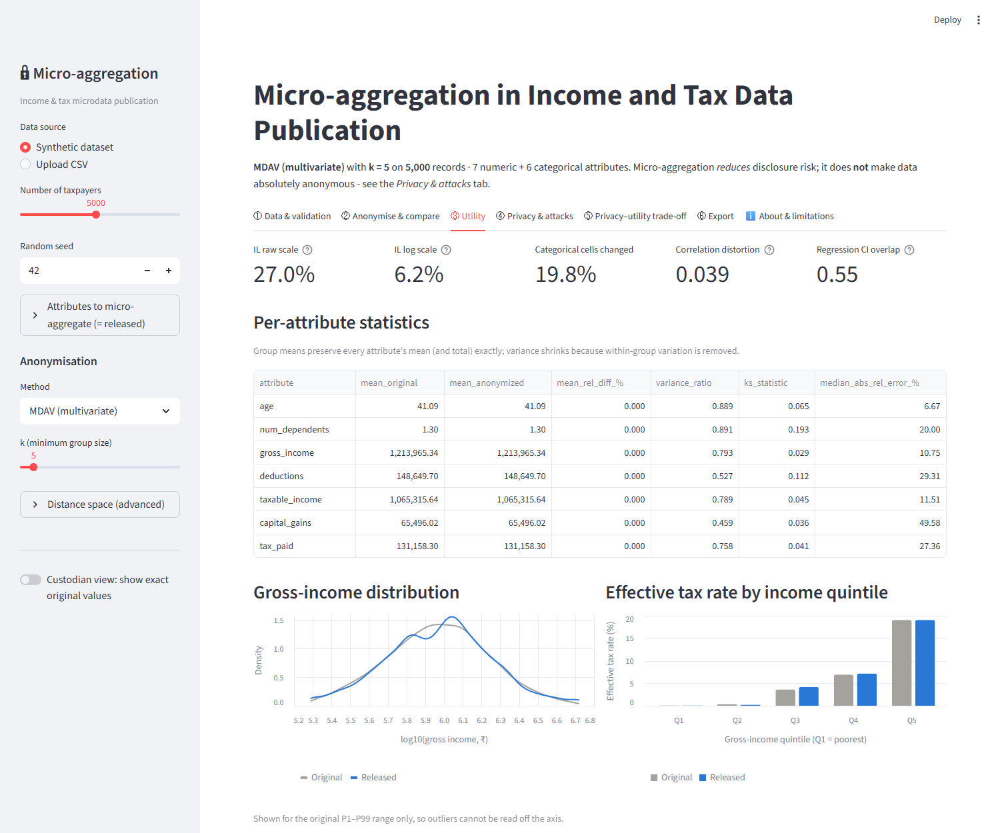
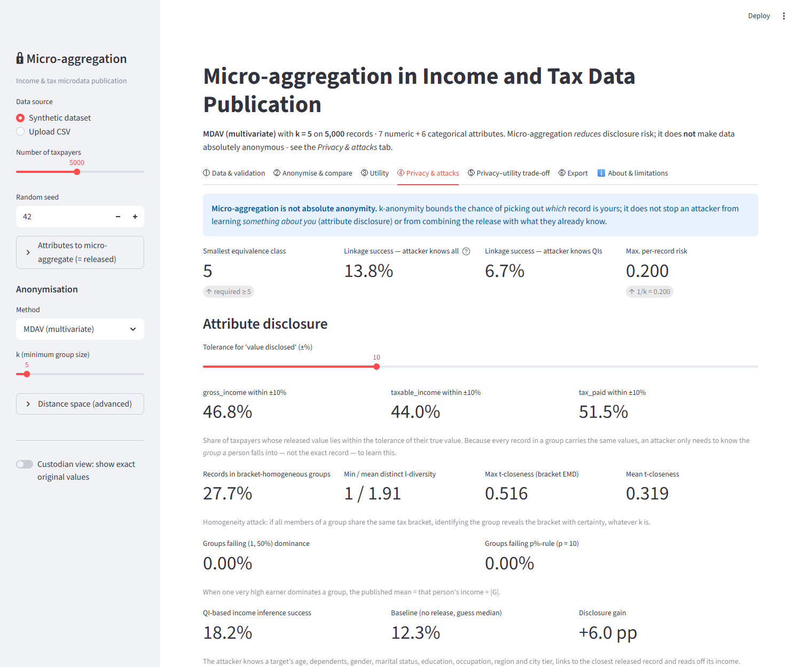
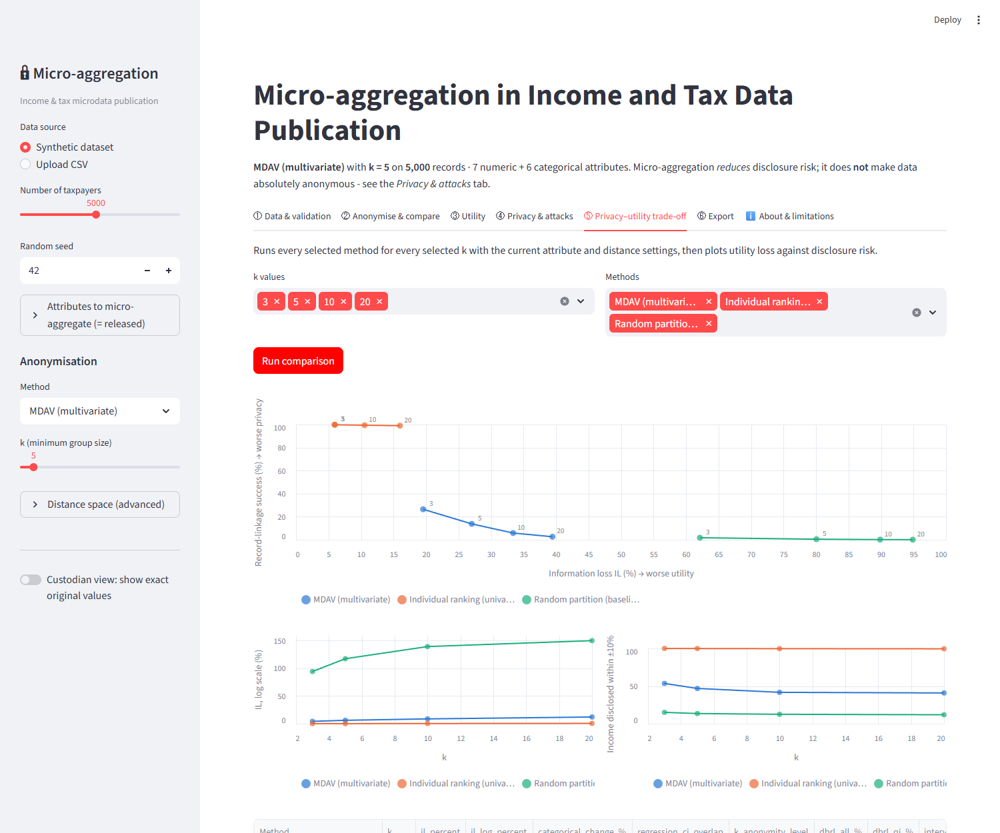

# Micro-aggregation for Income & Tax Data Publication

[](https://github.com/awasthiprashast/microaggregation-income-tax/actions/workflows/tests.yml)
[](https://microaggregation-income-tax.streamlit.app/)

[](LICENSE)

A complete, reproducible data-privacy project showing how **micro-aggregation (MDAV)** can protect
sensitive financial records in an income/tax microdata release while preserving statistical
utility — and, just as importantly, where it falls short. It includes the algorithm, a release
guard, a battery of utility and attack metrics, an interactive Streamlit dashboard and a full report.

> **Important:** micro-aggregation *reduces* disclosure risk; it does **not** make data absolutely
> anonymous. Attribute-disclosure and background-knowledge attacks remain possible and are
> measured explicitly in this project (see [Limitations](#limitations)).

**Live demo: <https://microaggregation-income-tax.streamlit.app/>**



## Real-data extension: diversity-aware MDAV (new)

The synthetic benchmark below was extended to **real data** (US Census ACS 2022 PUMS, California,
5,000 sampled persons: [`data/acs_ca_2022_sample.csv`](data/acs_ca_2022_sample.csv)) with three additions
in [`microagg/advanced.py`](microagg/advanced.py):

* **DA-MDAV**: MDAV on quasi-identifiers plus a swap/merge repair so every group is *l*-diverse and *t*-close on income band, still *k*-anonymous.
* **No-release baseline** for a machine-learning reconstruction attack, so only disclosure *caused by the release* is counted.
* **Group-level exposure** metrics (share of people in single-income-band groups) and a noisy-centroid negative result.

At k = 5, plain MDAV leaves 22.8 % of people in single-band groups; DA-MDAV leaves 0 % at 2.5x the information loss.
Reproduce with `python run_real_experiments.py` (needs the raw PUMS file, see `microagg/realdata.py`; ~20 min);
write-up in [`docs/CASE_STUDY.md`](docs/CASE_STUDY.md), results in [`results/real/`](results/real/).

## Highlights

* **MDAV micro-aggregation** from scratch (NumPy), k-anonymous on all released attributes, means and total tax revenue preserved exactly.
* **Two baselines**: individual ranking and random partition, to make the privacy–utility trade-off visible.
* **Release guard**: whitelisted columns, shuffled rows, fresh ids, enforced k-anonymity — unsafe releases cannot be exported.
* **Attack suite**: record linkage, interval disclosure, homogeneity / l-diversity / t-closeness, dominance and p%-rules, QI-inference, collusion.
* **Safe-by-default dashboard**: exact original values are hidden unless a custodian toggle is switched on.
* **Reproducible**: one command regenerates data, results, figures and the report; 26 unit tests.

## Dashboard

| | |
|---|---|
|  |  |
| **Data & validation** — cleaning, repairs, imputation | **Utility** — distributions, regression validity, tax-rule consistency |
|  |  |
| **Privacy & attacks** — linkage, disclosure, collusion | **Trade-off** — information loss vs. risk across k and methods |

## Results at a glance (seed 42, n = 5,000)

| Method | k | Information loss | Record-linkage success | Income within ±10 % |
|---|---:|---:|---:|---:|
| MDAV | 3 | 19.6 % | 26.5 % | 53.5 % |
| MDAV | 5 | 27.0 % | 13.8 % | 46.8 % |
| MDAV | 10 | 33.4 % | 5.9 % | 41.7 % |
| MDAV | 20 | 39.5 % | 2.7 % | 40.8 % |
| Individual ranking | 5 | 6.0 % | 99.8 % | 99.8 % |
| Random partition | 5 | 80.1 % | 0.5 % | 13.5 % |

MDAV keeps linkage risk below 1/k while individual ranking leaves records almost unique and
random grouping destroys utility. Full numbers: [`results/summary.csv`](results/summary.csv).


## Contents

| Deliverable | Where |
|---|---|
| Python source code | [`microagg/`](microagg/) package, [`run_experiments.py`](run_experiments.py) |
| Synthetic dataset | [`data/synthetic_income_tax.csv`](data/synthetic_income_tax.csv) (generated, seed 42) |
| Streamlit dashboard | [`app.py`](app.py) |
| Dependencies | [`requirements.txt`](requirements.txt), [`requirements-dev.txt`](requirements-dev.txt) |
| Algorithm explanation (maths, intuition, complexity) | [`docs/ALGORITHM.md`](docs/ALGORITHM.md) |
| Experimental results k = 3, 5, 10, 20 | [`results/summary.csv`](results/summary.csv), [`results/figures/`](results/figures/) |
| Privacy–utility comparison, conclusions, limitations | [`docs/REPORT.md`](docs/REPORT.md) §10–15 |
| Project report | [`docs/Project_Report.pdf`](docs/Project_Report.pdf) / `.docx`; Markdown source [`docs/REPORT.md`](docs/REPORT.md), generated from [`docs/report_template.md`](docs/report_template.md) |
| Unit tests | [`tests/test_microagg.py`](tests/test_microagg.py) |

## Setup

Requires Python 3.10+ (tested on 3.11).

```bash
python -m venv .venv
```

Activate it (Windows PowerShell: `.venv\Scripts\Activate.ps1`; macOS/Linux: `source .venv/bin/activate`), then:

```bash
pip install -r requirements.txt        # dashboard + library
pip install -r requirements-dev.txt    # adds pytest and python-docx (tests, report export)
```

## Running

**1. Reproduce all experiments, figures and the report** (~1.5 min; the scalability benchmark
takes most of it):

```bash
python run_experiments.py
```

Options: `--n 5000` records, `--seed 42`, `--k 3 5 10 20`, `--no-scalability`, `--quick`
(small smoke run, report not rendered).

**2. Launch the dashboard:**

```bash
streamlit run app.py
```

Then open http://localhost:8501. Tabs: data validation → anonymise & compare → utility →
privacy & attacks → trade-off across k → guarded export → about/limitations. You can generate
synthetic data of any size/seed or upload your own CSV and choose which attributes to aggregate.

**3. Export the report to Word and PDF** (PDF needs Microsoft Word on Windows):

```bash
python scripts/export_report.py --name "Your Name" --roll "Roll No." --instructor "Instructor" --institution "Institution"
```

Creates `docs/Project_Report.docx` and `docs/Project_Report.pdf` (cover page, table of contents, numbered figures).

**4. Run the tests:**

```bash
python -m pytest -q
```

**5. Use the library directly:**

```python
from microagg.data_generator import generate_income_tax_data
from microagg.preprocessing import validate_and_clean
from microagg.config import AnonymizationConfig
from microagg.anonymizer import anonymize
from microagg import release, utility, privacy

cfg = AnonymizationConfig(k=5, method="mdav")
clean, report = validate_and_clean(generate_income_tax_data(), cfg.numeric_attributes,
                                   cfg.categorical_attributes)
result = anonymize(clean, cfg)
released, checks = release.build_release(result)   # raises if not safe to publish
print(utility.compute_utility(result)["il_percent"], privacy.compute_privacy(result)["dbrl_all_%"])
```

## Dataset

`data/synthetic_income_tax.csv` is produced by `microagg/data_generator.py` with a fixed seed;
no real person is represented. 5,000 taxpayers + 10 duplicate rows, ~3 % missing cells and a few
invalid entries (age 150, "?" in a numeric column, negative income, 25 dependents, " male ") so
that validation is exercised.

| Column | Role | Description |
|---|---|---|
| `taxpayer_id` | direct identifier | never released |
| `age`, `num_dependents` | numeric quasi-identifiers | 21–85 years; 0–6 dependents |
| `gender`, `marital_status`, `education`, `occupation`, `region`, `city_tier` | categorical quasi-identifiers | correlated with age and income |
| `gross_income` | confidential | log-normal by occupation/education/experience/tier + Pareto tail (₹) |
| `deductions` | confidential | standard + investment + health + home-loan (₹) |
| `taxable_income` | confidential | max(gross − deductions, 0) |
| `capital_gains` | confidential | zero for most, log-normal otherwise |
| `tax_paid` | confidential | stylised progressive schedule with rebate, surcharge, cess |
| `tax_bracket` | derived confidential | marginal slab; **never released** |

The tax schedule in `microagg/tax.py` is loosely modelled on Indian slabs for realism and is
**illustrative only** — not an implementation of tax law.

## Method in brief

1. **Validate & clean** — schema, types, ranges, edit rules, exact repair via
   taxable = gross − deductions, median-within-occupation / mode imputation.
2. **Encode** — z-scores, log1p for money, weighted one-hot for categories.
3. **Partition with MDAV** — groups of k…2k−1 similar records, built from the most extreme
   records inwards. Time **O(n²·d/k)**, memory **O(n·d)** (verified empirically).
4. **Aggregate** — one partition for all attributes; mean (numeric) and mode (categorical) ⇒
   k-anonymity on the released attributes; means and totals preserved exactly.
5. **Release guard** — whitelist of aggregated columns, rows shuffled, fresh ids, k-anonymity
   check; unsafe releases (e.g. individual ranking) cannot be exported.
6. **Evaluate** — information loss, distributional and regression validity, tax-rule
   consistency; record linkage, interval disclosure, homogeneity/l-diversity/t-closeness,
   dominance and p %-rules, QI-inference attack, collusion attack.

Baselines: **individual ranking** (per-attribute micro-aggregation) and **random partition**.

## How original values are kept from leaking

* Export only through `release.build_release()` (whitelist, shuffle, fresh ids, k-anonymity check).
* Dashboard shows original monetary values only as bands and ages as decades, never min/max,
  never per-record errors (released value + error would reveal the original), and trims
  distribution plots to P1–P99.
* Exact originals are visible only after switching on the off-by-default **custodian view**.
* The saved record comparison (`results/record_comparison_mdav_k5.csv`) uses bands as well.

## Limitations

* Not absolute anonymity: k-anonymity bounds *identity* disclosure only.
* Attribute disclosure: similar taxpayers are grouped, so released incomes are close to true ones;
  homogeneous groups reveal tax brackets.
* Background knowledge: knowing the other k−1 members of a group reveals the last one exactly.
* Multiple releases of the same population enable differencing.
* Variances, inequality and non-linear tax rules are distorted; rare categories can vanish.
* Quadratic runtime; heuristic (not optimal) partition; synthetic data only.

## Project layout

```
microagg/            library (config, tax, data_generator, preprocessing, features, mdav,
                     anonymizer, release, utility, privacy, safe_display, experiments,
                     plotting, report_builder)
app.py               Streamlit dashboard
run_experiments.py   reproduces data, results, figures and docs/REPORT.md
data/                synthetic dataset
results/             metrics (CSV/JSON), guarded releases, figures
docs/                ALGORITHM.md, report_template.md, REPORT.md, Project_Report.pdf/.docx, screenshots/
tests/               pytest suite
scripts/             report export (Word/PDF) and architecture diagram
.github/workflows/   CI (pytest on Python 3.10–3.12)
```

## License

Released under the [MIT License](LICENSE). The dataset is entirely synthetic.
