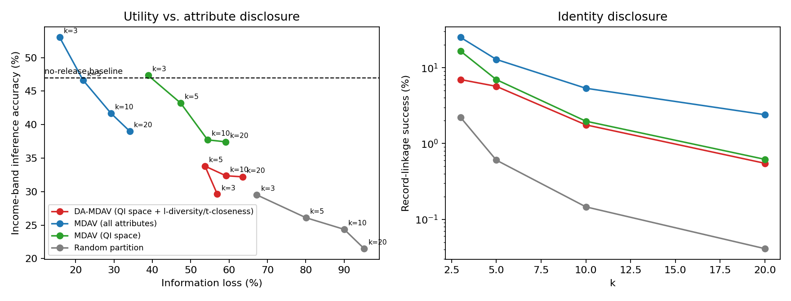
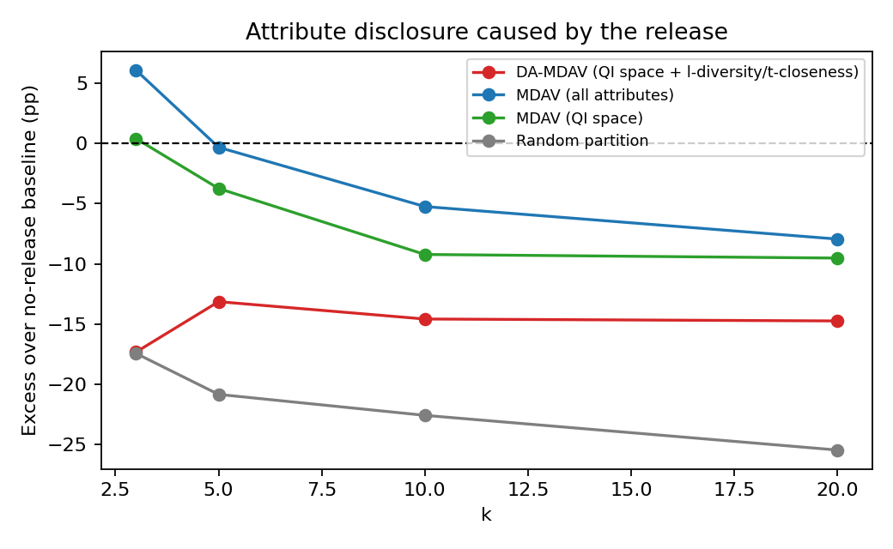
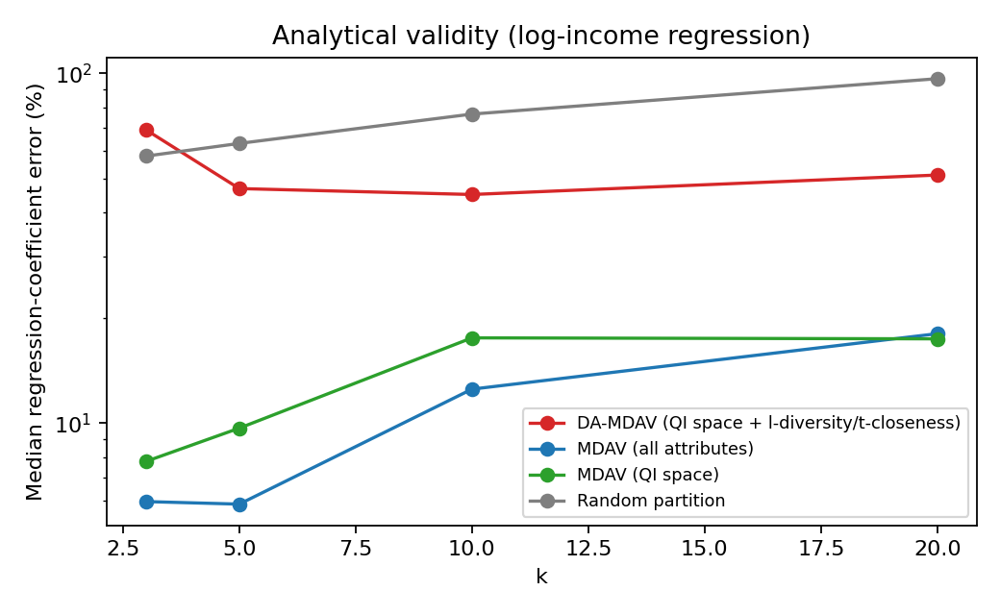

# Diversity-Aware Micro-aggregation for Publishing Real Income Microdata

## Abstract

Statistical agencies release person-level income microdata for research, but income is among the most sensitive attributes a person has. Micro-aggregation with the MDAV heuristic (Maximum Distance to Average Vector) is a standard remedy: records are grouped into clusters of at least *k* similar people and each person is replaced by their cluster average, which gives *k*-anonymity. This case study evaluates MDAV on **real data** (5,000 persons drawn from the US Census Bureau's 2022 American Community Survey microdata) and shows a weakness that *k*-anonymity hides: on this data **22.8 % of people sit in a group where every member falls in the same income band** (*k* = 5), and 75.6 % of groups contain fewer than three distinct bands, even though record-linkage risk is only 12.9 %. The study contributes (i) a **diversity-aware MDAV (DA-MDAV)** that builds the partition on quasi-identifiers and then repairs groups by local swaps and merges until every group is *l*-diverse (l = 3) and *t*-close (t = 0.25) on income band; (ii) a **no-release baseline** for a machine-learning reconstruction attack, so that only the disclosure *caused by the release* is counted; and (iii) a negative result on Laplace-noised centroids. DA-MDAV removes homogeneous groups completely (0 %) at *k* = 5 while keeping every group at size *k*, at the price of higher information loss (53.7 % against 21.9 %) and weaker regression validity. The results are stable over three independent samples.

## 1. Problem and motivation

A tax authority or statistics office wants to publish a file with one row per person: age, education, occupation, hours worked and several income components. Removing names is not enough. Sweeney showed that a few demographic attributes (*quasi-identifiers*) can uniquely identify a person when linked to a public register, and the income columns are the *confidential* attributes the release is meant to protect.

Two distinct harms must be controlled:

* **Identity disclosure**: an attacker links a released row to a known person.
* **Attribute disclosure**: an attacker learns a person's income, or narrows it, without identifying a single row. *k*-anonymity does not bound this: if all *k* members of a group earn about the same, knowing the group reveals the income (the homogeneity problem that motivated *l*-diversity and *t*-closeness).

**Case-study question.** *How well does plain MDAV protect real income data against both harms, and can a diversity-aware variant close the gap at an acceptable utility cost?*

## 2. Data

The first version of this project used a synthetic taxpayer file. Synthetic data is convenient but its correlations are whatever the generator author wrote, so conclusions about attack success would be circular. This version uses **real survey records**:

* **Source:** US Census Bureau, American Community Survey 2022 1-year Public Use Microdata Sample (PUMS), California person file. It is public, de-identified and free to use (`census.gov`, no login).
* **Filter and sample:** adults aged 18–90 with positive personal income; a random sample of **5,000 persons** (the *release sample*) and a second, disjoint random sample of 5,000 (the *reference sample*, used only as public population knowledge by the baseline attack). All dollar amounts are converted to 2022 dollars with the Census adjustment factor; net losses in self-employment and investment income are recoded to zero.
* **Quasi-identifiers:** age, usual weekly hours (numeric); sex, marital status, education (5 levels), worker class, occupation group (25 levels), race, nativity, disability (categorical).
* **Confidential attributes:** total personal income, wages, self-employment income, investment income, retirement income.
* **Sensitive class:** the quintile of total income (*income band* 0–4), used by the diversity constraints and to score attacks; it is never released.

Real income is zero-inflated and heavy-tailed (median \$41.7k, mean \$74.8k, Gini 0.575), which is exactly the setting where grouping by similarity and averaging is hard.

## 3. Methods

### 3.1 MDAV

MDAV maps each record to a numeric vector (standardised numbers, one-hot categories, log scale for money) and repeatedly (1) finds the record farthest from the centroid of the remaining data, (2) forms a group from it and its *k*−1 nearest neighbours, (3) does the same for the record farthest from that one, until fewer than 3*k* records remain. Every group has *k* members except the last (between *k* and 2*k*−1). Time is O(n²·d/k). Each person is then replaced by the group mean (numeric) or mode (categorical), so every released row is identical to at least *k*−1 others, and means and totals are preserved exactly.

### 3.2 Methods compared

| Method | Partition built on | Constraint on income |
|---|---|---|
| MDAV (all) | all attributes incl. incomes (standard) | none |
| MDAV (QI) | quasi-identifiers only | none |
| DA-MDAV *(new)* | quasi-identifiers, then repaired | every group *l*-diverse and *t*-close |
| Random partition | random groups of *k* | none (reference point) |

**MDAV (QI)** isolates a design choice: when incomes take part in the clustering, people with similar income land together and the group mean is close to each member's true income. Clustering on quasi-identifiers only makes members look alike to an attacker but earn different amounts.

### 3.3 Diversity-aware MDAV (contribution)

Start from the MDAV (QI) partition. A group is **valid** if it contains at least *l* = 3 distinct income bands and the earth mover's distance (ordered scale) between its band distribution and the population's is at most *t* = 0.25 (*t*-closeness, Li et al. 2007). For every invalid group:

1. **Swap step.** Examine the 60 nearest groups in quasi-identifier space and swap one record of the group with one record of a neighbour when this lowers the total violation score of the two groups; a small distance penalty keeps swaps local. Group sizes do not change.
2. **Merge step (fallback).** Any group still invalid is merged with the nearby group giving the lowest EMD. Groups only grow, so *k*-anonymity is preserved by construction.

Because swaps and merges never shrink a group, DA-MDAV is *k*-anonymous exactly like MDAV. The additional guarantee is on the income distribution inside each group.

### 3.4 Noisy centroids (negative result)

Following the idea of combining microaggregation with differential privacy (Soria-Comas et al. 2014), Laplace noise with scale (hi − lo)/(group size · ε/5) is added to each group's confidential means after clipping at the 1st/99th percentile. The partition depends on the data, so this is *DP-inspired* and not a formal ε-DP guarantee.

### 3.5 Attacks and the no-release baseline

* **Record linkage.** The attacker knows all attributes of a target and links to the nearest released record; expected success counts 1/|group| when the nearest group is the true one.
* **QI-linkage attribute attack.** The attacker knows only the target's quasi-identifiers, finds the nearest released group and reads its income; success is predicting the correct income band.
* **Machine-learning reconstruction attack.** A random forest is trained on the released file to predict income band from quasi-identifiers, then applied to the real people.
* **No-release baseline.** The same random forest trained on the *reference sample* (no release at all) predicts the band correctly **46.9 %** of the time (chance is 20 %), because education, hours and occupation genuinely predict income. A release only causes *excess* disclosure when an attack beats this baseline. Without it, the high accuracy of the attacks would wrongly be blamed on the anonymisation.
* **Group-level exposure.** Share of people in groups with a single income band (the attacker who knows a person's group learns their band with certainty), and share of groups with fewer than three bands.

### 3.6 Utility measures

Information loss (SSE/SST on standardised numeric attributes), preservation of the mean, Gini coefficient and correlation matrix, and **regression validity**: median relative error of the coefficients of a log-income regression on age, age², hours, sex and education fitted on the original and the released data.

## 4. Results (k = 5 unless stated)

All numbers come from `run_real_experiments.py` (seed 42; raw results in `results/real/`).

**Table 1. Comparison at k = 5.**

| Method | Info. loss % | Record linkage % | Records in single-band groups % | Groups with < 3 bands % | QI-linkage band acc. % | ML band acc. % | Regression coef. error % |
|---|---:|---:|---:|---:|---:|---:|---:|
| MDAV (all) | 21.9 | 12.9 | 22.8 | 75.6 | 46.6 | 48.3 | 5.9 |
| MDAV (QI) | 47.4 | 7.0 | 4.4 | 37.3 | 43.2 | 43.3 | 9.7 |
| DA-MDAV | 53.7 | 5.7 | 0.0 | 0.0 | 33.8 | 35.2 | 46.8 |
| Random | 80.0 | 0.6 | 0.1 | 9.5 | 26.1 | 29.0 | 63.0 |
| *No-release baseline* | – | – | – | – | *46.9* | *46.9* | – |

**Finding 1: aggregate attacks look harmless, group-level exposure is not.** At *k* = 5 standard MDAV's attribute attack (46.6 %) is no better than the no-release baseline (46.9 %), so the release adds little *on average*. At *k* = 3 it does add 6.1 points (53.0 %). But 22.8 % of people sit in groups whose members all share one income band, and that share only falls to 12.4 % at *k* = 10 and 11.2 % at *k* = 20. For those people, group membership reveals the band with certainty, which an average accuracy figure conceals.

**Finding 2: where the partition is built matters.** Moving the clustering from all attributes to quasi-identifiers alone cuts record linkage from 12.9 % to 7.0 % and single-band exposure from 22.8 % to 4.4 %, but information loss rises from 21.9 % to 47.4 %: the group means no longer follow each person's own income.

**Finding 3: DA-MDAV gives a guarantee the others cannot.** Every group has at least three distinct bands and EMD ≤ 0.25 at every *k*, with zero single-band exposure, group size exactly *k* at *k* = 5 and average size 4.2–20.3 for the other *k*. Against the random baseline it has lower information loss (53.7 % against 80.0 %) and lower regression error, while keeping the exact means and totals. Its cost is real: the regression coefficient error is 46.8 % against 5.9 % for plain MDAV, and attribute-inference accuracy drops *below* the baseline (33.8 % against 46.9 %), meaning the released file is less informative about income than the public is, a sign of over-protection for analysts.

**Table 2. Effect of k on the two ends of the trade-off.**

| *k* | MDAV (all): loss % | linkage % | single-band % | DA-MDAV: loss % | linkage % | single-band % |
|---:|---:|---:|---:|---:|---:|---:|
| 3 | 15.8 | 25.2 | 39.8 | 56.9 | 7.0 | 0.0 |
| 5 | 21.9 | 12.9 | 22.8 | 53.7 | 5.7 | 0.0 |
| 10 | 29.2 | 5.4 | 12.4 | 59.2 | 1.8 | 0.0 |
| 20 | 34.1 | 2.4 | 11.2 | 63.5 | 0.55 | 0.0 |

**Finding 4: the constraint strength is a tunable dial.** Table 3 sweeps (*l*, *t*) at *k* = 5. Loosening to (2, 0.40) halves the regression error (25.0 %) while still guaranteeing two bands per group; tightening to (4, 0.20) costs 60.3 % error. Weaker settings needed merges (largest group 20–35 records) while (3, 0.25) was met by swaps alone.

**Table 3. DA-MDAV constraint sweep, k = 5.**

| *l* | *t* | Info. loss % | Linkage % | Largest group | QI-linkage band acc. % | Regression error % |
|---:|---:|---:|---:|---:|---:|---:|
| 2 | 0.40 | 51.0 | 6.0 | 35 | 39.7 | 25.0 |
| 3 | 0.30 | 54.4 | 5.4 | 20 | 34.4 | 38.3 |
| 3 | 0.25 | 53.7 | 5.7 | 5 | 33.8 | 46.8 |
| 4 | 0.20 | 58.1 | 4.4 | 20 | 27.3 | 60.3 |

**Finding 5: noisy centroids are not usable at these group sizes (negative result).** With ε = 5 information loss is 119 % and the mean income is off by 65 %; with ε = 1 loss is 2,113 % and the mean is off by 435 %, because the noise scale (range ÷ group size) is far larger than the signal in a group of five. Only exact aggregation preserves the totals. Differential privacy by centroid noise therefore needs groups far larger than *k* = 5, or formally insensitive partitions, which this study does not attempt.

**Robustness.** Repeating *k* = 5 on three further independent samples (different random people) gives information loss 22.4 ± 1.8 % (MDAV all) and 52.7 ± 0.05 % (DA-MDAV), record linkage 12.94 ± 0.05 % and 5.71 ± 0.18 %, and QI-linkage band accuracy 46.7 ± 0.4 % and 34.0 ± 0.9 %: the ordering of methods does not depend on the sample.

## 5. Discussion

**What is different from plain MDAV.** (a) The evaluation is on real data. (b) Disclosure is measured against a no-release baseline, separating risk caused by the release from what the public could infer anyway. (c) Group-level exposure (single-band groups) is reported next to averages. (d) DA-MDAV turns *l*-diversity and *t*-closeness, usually applied to generalisation, into a repair step for micro-aggregated groups while keeping *k*-anonymity and exact totals.

**What the numbers say to a data custodian.** At *k* ≥ 10, plain MDAV adds no attribute disclosure beyond the public baseline and linkage is 5.4 % or lower, but about one person in eight is still in a single-band group. If that matters, DA-MDAV removes it entirely; if regression analyses matter more, use MDAV with *k* ≥ 10 or the relaxed (2, 0.40) constraint.

**Limitations.**

* One state and year, and a sample of 5,000 persons (the algorithm is O(n²), so DA-MDAV took 44 s at *k* = 5 and 308 s at *k* = 20).
* The sensitive attribute is one derived quantity (income quintile); other sensitive columns are not constrained.
* The swap-and-merge repair is a greedy heuristic, not an optimum. It reached the constraints in all main runs, but no optimality or utility bound is proved.
* The ML attack uses a random forest on quasi-identifiers; a stronger attacker with side information on group membership (collusion) is covered only by the single-band exposure measure.
* Noisy centroids are DP-inspired and carry no formal ε-DP guarantee.
* PUMS is itself a disclosure-limited public file; re-releasing it protects nothing new in practice and serves as a realistic test bed only.

## 6. Conclusion

Micro-aggregation with MDAV keeps real income data useful (21.9 % information loss, exact means and totals) and holds identity risk below 1/*k* in expectation, but its *k*-anonymity guarantee leaves nearly a quarter of people in groups with a single income band at *k* = 5. A diversity-aware repair removes that exposure completely at the same group size, and the evaluation shows the price: roughly 2.5× the information loss and weaker regression validity. The no-release baseline shows that this extra protection takes the attacker below what public knowledge already gives, so (*l*, *t*) should be chosen deliberately, not maximised. Future work: a utility-aware repair that selects swaps by regression impact, formal differential privacy via insensitive microaggregation, a diversity constraint across several sensitive attributes, and linear-time partitioning for millions of records.

## References

1. Domingo-Ferrer, J. & Mateo-Sanz, J. M. (2002). Practical data-oriented microaggregation for statistical disclosure control. *IEEE Transactions on Knowledge and Data Engineering* 14(1), 189–201.
2. Domingo-Ferrer, J. & Torra, V. (2005). Ordinal, continuous and heterogeneous *k*-anonymity through microaggregation. *Data Mining and Knowledge Discovery* 11(2), 195–212.
3. Sweeney, L. (2002). *k*-anonymity: a model for protecting privacy. *International Journal of Uncertainty, Fuzziness and Knowledge-Based Systems* 10(5), 557–570.
4. Machanavajjhala, A., Kifer, D., Gehrke, J. & Venkitasubramaniam, M. (2007). *l*-diversity: privacy beyond *k*-anonymity. *ACM TKDD* 1(1).
5. Li, N., Li, T. & Venkatasubramanian, S. (2007). *t*-closeness: privacy beyond *k*-anonymity and *l*-diversity. *Proc. IEEE ICDE*, 106–115.
6. Soria-Comas, J., Domingo-Ferrer, J., Sánchez, D. & Martínez, S. (2014). Enhancing data utility in differential privacy via microaggregation-based *k*-anonymity. *The VLDB Journal* 23(5), 771–794.
7. Soria-Comas, J., Domingo-Ferrer, J., Sánchez, D. & Martínez, S. (2015). *t*-closeness through microaggregation: strict privacy with enhanced utility preservation. *IEEE TKDE* 27(11), 3098–3110.
8. Dwork, C., McSherry, F., Nissim, K. & Smith, A. (2006). Calibrating noise to sensitivity in private data analysis. *Proc. TCC*, 265–284.
9. Hundepool, A. et al. (2012). *Statistical Disclosure Control*. Wiley.
10. US Census Bureau. *American Community Survey 2022 1-Year Public Use Microdata Sample, California*. https://www.census.gov/programs-surveys/acs/microdata.html

**Code and data:** https://github.com/awasthiprashast/microaggregation-income-tax (`microagg/advanced.py`, `run_real_experiments.py`, `results/real/`).
