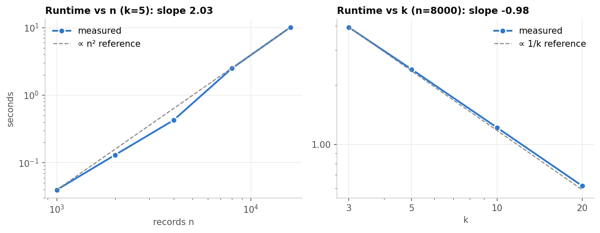
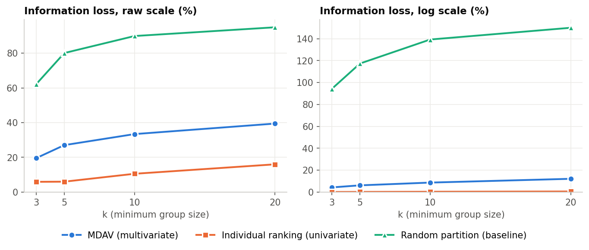
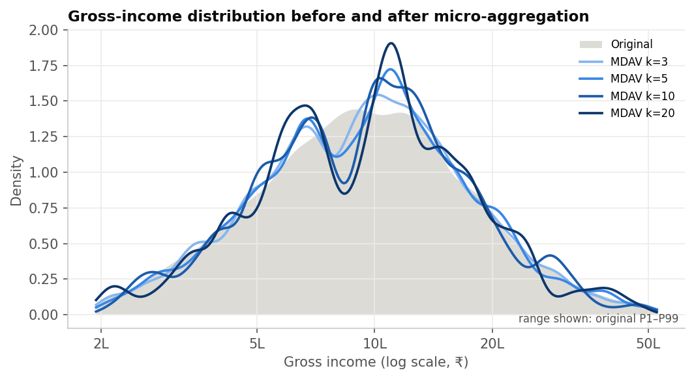
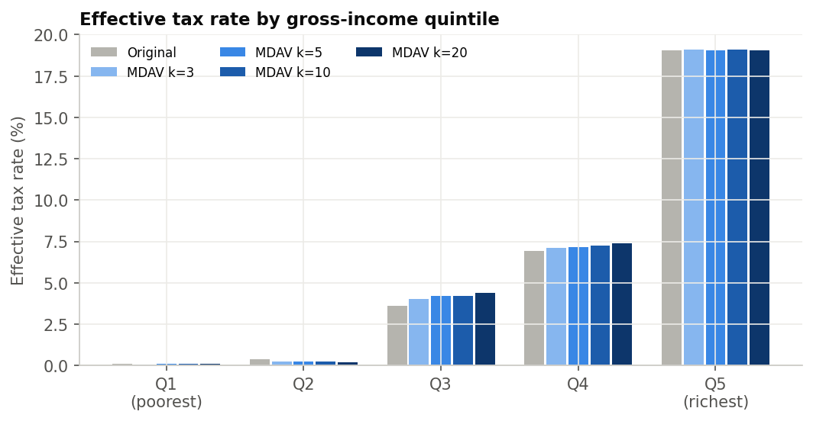
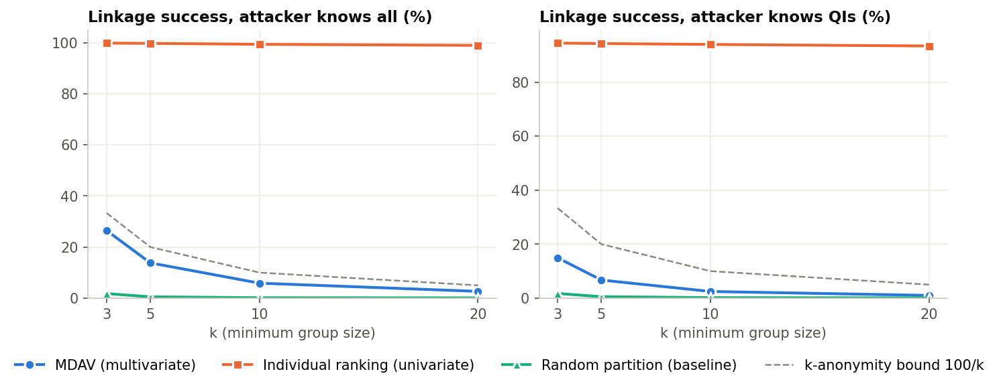
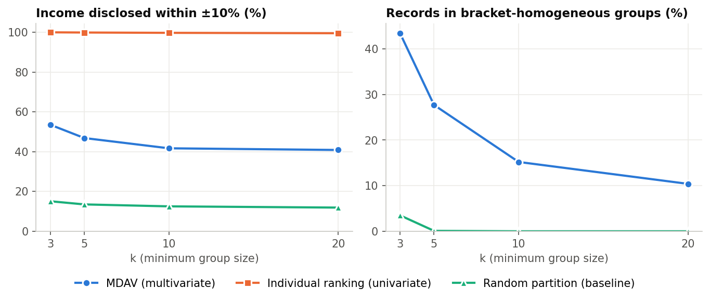
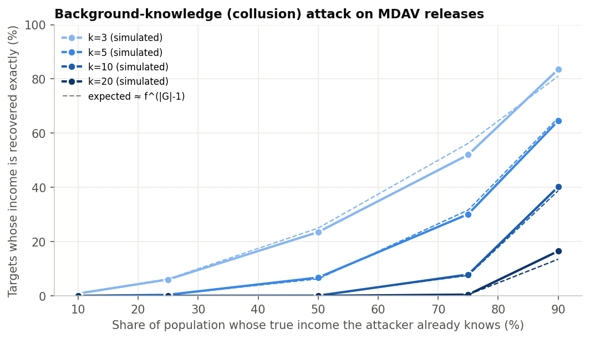
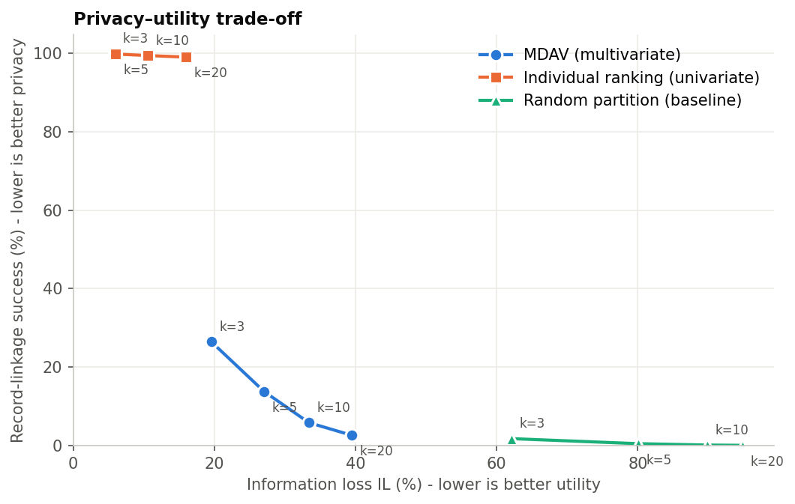
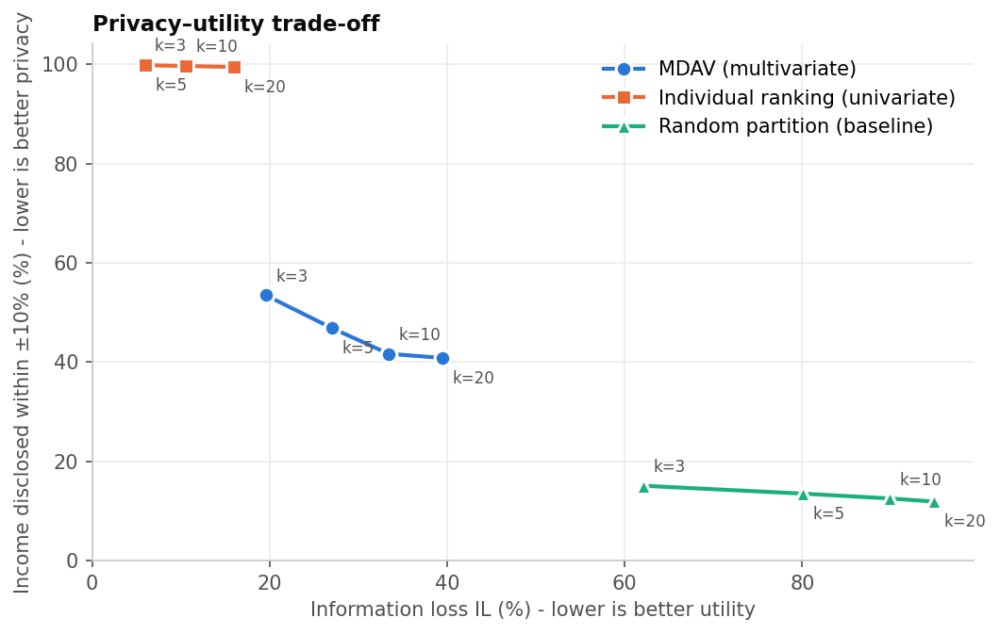

<!--
  docs/REPORT.md is GENERATED from docs/report_template.md by
  `python run_experiments.py`. Double-brace placeholders are filled with computed results
  (see microagg/report_builder.py).
-->

# Micro-aggregation in Income and Tax Data Publication – Implementation

**Project report** · Data Privacy · synthetic dataset of 5000 taxpayers · random seed 42

> Every number in this report was produced by `run_experiments.py` (Python 3.11.9,
> NumPy 1.26.4, pandas 3.0.5) and inserted automatically. Re-running the script with
> the same seed reproduces them exactly; a different seed or dataset regenerates the report.

---

## Abstract

Tax administrations and statistical offices are asked to publish income and tax microdata for
research and policy analysis, but such records are among the most sensitive personal data. This
project implements **micro-aggregation** with the **MDAV** (Maximum Distance to Average Vector)
heuristic as a statistical disclosure control method for an income/tax dataset, together with an
end-to-end pipeline: synthetic data generation, validation and imputation, anonymisation, a
release guard, utility and disclosure-risk evaluation, attack simulations and an interactive
Streamlit dashboard. On 5000 synthetic taxpayers, MDAV with k = 3, 5, 10, 20 yields
k-anonymous releases whose record-linkage success falls from 26.5 % to
2.6 % while information loss (log scale) rises from 4.3 %
to 12.1 % and means and totals (e.g. total tax revenue) are preserved exactly.
The experiments also show the limits of the method: even at k = 20, 40.8 %
of taxpayers have their published income within ±10 % of the truth, and an attacker who knows
the incomes of 90 % of the population recovers 14.0 % of the remaining
incomes exactly. Micro-aggregation substantially reduces, but does not eliminate, disclosure risk.

## 1. Introduction

Income-tax microdata – one record per taxpayer with demographics, income components, deductions
and tax – are invaluable for evaluating tax reforms, measuring inequality and forecasting revenue.
Releasing them as-is, even without names, is unsafe: a combination of age, region, occupation and
family situation is often unique, and anyone who can single a person out learns their income and
tax. Statistical disclosure control (SDC) offers *masking* methods that perturb the data so that
individuals are protected while aggregate statistics remain useful.

Micro-aggregation is a masking method designed for continuous data. It groups similar records
into clusters of at least *k* records and publishes the cluster averages instead of the individual
values. It is used by statistical agencies (it is implemented in μ-ARGUS and sdcMicro) and,
with a joint partition, it yields *k*-anonymity for numerical data (Domingo-Ferrer & Torra, 2005).

## 2. Problem statement

Given a microdata file of taxpayers with direct identifiers, quasi-identifiers (QIs) and
confidential financial attributes, produce a releasable file such that

1. no released record can be linked to a specific taxpayer with probability above 1/k,
2. original confidential values are not exposed – neither in the released file nor in the tools
   used to produce it,
3. the released file supports the analyses tax researchers actually run (means, totals,
   distributions, inequality, effective tax rates, regression), and
4. the residual disclosure risk is measured and reported honestly.

## 3. Objectives

* Implement MDAV micro-aggregation, cleanly and reproducibly, with documented complexity.
* Build a realistic synthetic income/tax population with correlated attributes and heavy tails.
* Validate input data and handle missing and invalid values.
* Quantify utility (information loss, distributional and analytical validity) and risk
  (identity and attribute disclosure, attack simulations) for k = 3, 5, 10, 20.
* Compare MDAV with univariate (individual ranking) and random-partition baselines.
* Provide an interactive dashboard and an export path that cannot leak original values.
* Discuss limitations and attacks explicitly.

## 4. Literature and conceptual background

**Statistical disclosure control.** SDC distinguishes *identity disclosure* (a released record is
linked to a person) from *attribute disclosure* (something is learnt about a person, whether or
not their record is found) (Hundepool et al., 2012). Masking methods are either
non-perturbative (suppression, generalisation) or perturbative (noise, swapping,
micro-aggregation).

**k-anonymity** (Sweeney, 2002) requires every combination of QI values to be shared by at least
*k* records. It bounds identity disclosure but is vulnerable to the *homogeneity* and
*background-knowledge* attacks, which motivated **l-diversity** (Machanavajjhala et al., 2007) and
**t-closeness** (Li et al., 2007).

**Micro-aggregation.** Defay & Nanopoulos (1992) introduced fixed-size micro-aggregation;
Domingo-Ferrer & Mateo-Sanz (2002) formalised it as minimising the within-group sum of squares
subject to a minimum group size, showed that optimal groups have between k and 2k−1 records, and
proposed MDAV. Optimal multivariate micro-aggregation is NP-hard (Oganian & Domingo-Ferrer, 2001);
the univariate case has a polynomial optimum (Hansen & Mukherjee, 2003). Domingo-Ferrer & Torra
(2005) showed that micro-aggregating all QIs with a joint partition achieves k-anonymity for
continuous data. Variants include V-MDAV (variable group sizes) and MD-MHM.

**Tabular confidentiality rules.** Tax agencies protect published cells with the
*(n, k)-dominance* and *p %-rule*, which flag cells where one or two contributors dominate the
total; the same logic applies to a micro-aggregated group mean.

**Differential privacy** (Dwork, 2006) offers a formal guarantee against arbitrary auxiliary
information, at the price of calibrated noise; micro-aggregation offers no such guarantee.

## 5. Methodology

```
raw CSV ──► validation & cleaning ──► distance-space encoding ──► partition (MDAV | IR | random)
                                                                          │
           release guard ◄── shuffle & drop ids ◄── aggregation (mean / mode, one partition)
                 │
                 └──► released CSV + metadata          utility & risk metrics ◄── (internal only)
```

1. **Data.** A synthetic population generated with a fixed seed (Section 9).
2. **Validation and cleaning** (`preprocessing.py`): schema check, label normalisation,
   de-duplication, numeric coercion, domain ranges, edit rules (deductions ≤ gross income),
   *deductive repair* with the identity taxable = gross − deductions, removal of mostly-empty
   rows, median imputation within occupation (numeric) and mode imputation (categorical),
   recomputation of tax when missing.
3. **Encoding** (`features.py`): z-scores, log1p for monetary attributes, weighted one-hot
   encoding for categories (weight 1/√2).
4. **Partitioning** with MDAV; baselines: individual ranking and random partition.
5. **Aggregation** with a single partition for all attributes: mean (numeric), mode (categorical).
6. **Release** (`release.py`): whitelist of aggregated attributes, rounding, seeded shuffle, fresh
   `release_id`, and blocking checks (k-anonymity, completeness, id hygiene).
7. **Evaluation** (`utility.py`, `privacy.py`) on the internal, row-aligned original/anonymised
   pair – never exported.

## 6. The MDAV algorithm

MDAV repeatedly takes the record *r* farthest from the centroid of the unassigned records and
the record *s* farthest from *r*, and forms a group from each of them with their k−1 nearest
neighbours, until fewer than 3k records remain; then it forms one or two final groups so that
every group has between k and 2k−1 records. Each record is replaced by its group centroid.

*Intuition.* Extreme records are the hardest to hide, so they are grouped first, while they still
have the largest choice of neighbours; *r* and *s* lie at opposite ends of the cloud, so the two
groups formed in each round do not compete for the same neighbours.

*Complexity.* An iteration over *m* remaining records computes three distance vectors
(O(md)) and two linear-time k-selections, and removes 2k records. Over n/(2k) iterations:

T(n) = Σᵢ O(d·(n − 2ki)) ≈ O(n²·d / 4k) = **O(n² d / k)** time, **O(n d)** memory.

Measured on 34-dimensional encodings, the log–log slope of runtime is
**2.03** in *n* and **-0.98** in *k*, matching the predicted exponents 2 and −1.

| Sweep | n | k | d | Seconds |
|---|---|---|---|---|
| n | 1000 | 5 | 34 | 0.040 |
| n | 2000 | 5 | 34 | 0.130 |
| n | 4000 | 5 | 34 | 0.425 |
| n | 8000 | 5 | 34 | 2.496 |
| n | 16000 | 5 | 34 | 10.100 |
| k | 8000 | 3 | 34 | 3.922 |
| k | 8000 | 5 | 34 | 2.400 |
| k | 8000 | 10 | 34 | 1.217 |
| k | 8000 | 20 | 34 | 0.615 |



Full derivations, a worked example and proofs are in [`docs/ALGORITHM.md`](ALGORITHM.md).

## 7. Implementation

| Module | Responsibility |
|---|---|
| `microagg/config.py` | attribute roles, valid ranges, `AnonymizationConfig` |
| `microagg/tax.py` | stylised progressive tax schedule (slabs, rebate, surcharge, cess) |
| `microagg/data_generator.py` | reproducible synthetic population + injected dirt |
| `microagg/preprocessing.py` | validation, edit rules, deductive repair, imputation |
| `microagg/features.py` | distance-space encoder |
| `microagg/mdav.py` | MDAV, individual ranking, random partition, aggregation |
| `microagg/anonymizer.py` | pipeline returning an internal `AnonymizationResult` |
| `microagg/release.py` | release builder and release guard |
| `microagg/utility.py`, `privacy.py` | utility metrics, risk metrics, attacks |
| `microagg/safe_display.py` | banding / safe summaries for anything shown on screen |
| `microagg/experiments.py`, `plotting.py`, `report_builder.py` | experiments, figures, this report |
| `app.py` | Streamlit dashboard |
| `tests/test_microagg.py` | unit tests (group-size invariants, determinism, k-anonymity, guard, validation) |

**Safeguards against accidental exposure.** (i) The release is built from a *whitelist* of
aggregated attributes; `taxpayer_id` and the derived `tax_bracket` can never be exported.
(ii) Rows are shuffled with a seeded permutation and re-numbered, so row order cannot be joined
back to the source. (iii) The release guard blocks any file that is not k-anonymous – in the
experiments it blocked: *individual_ranking_k3, individual_ranking_k5, individual_ranking_k10, individual_ranking_k20*. (iv) The dashboard shows original monetary values only
as bands, never shows per-record errors (released value + error = original), never shows the
minimum or maximum of an original attribute, trims distribution plots to P1–P99, and keeps exact
originals behind an explicit, off-by-default *custodian view*. (v) All randomness is seeded.

## 8. Experimental setup

* **Data:** 5010 raw rows → 5000 clean records after removing
  10 duplicates; 263 cells repaired exactly through the
  accounting identity and 1010 cells imputed; 0 rows dropped.
* **Released attributes:** age, dependents, gross income, deductions, taxable income, capital
  gains, tax paid (numeric); gender, marital status, education, occupation, region, city tier
  (categorical). All are micro-aggregated with one partition.
* **Methods:** MDAV; individual ranking (IR); random partition. **k ∈ { 3, 5, 10, 20 }.**
* **Attacker models:** (a) worst case – the attacker holds the original records (DBRL on all
  attributes); (b) the attacker knows the QIs only; (c) the attacker knows the true incomes of a
  share *f* of the population (collusion).
* **Validation of cleaning:**

| Column | Missing | Non-numeric | Out of range | Rule violations | Repaired (identity) | Imputed |
|---|---|---|---|---|---|---|
| age | 159 | 9 | 23 | 0 | 0 | 191 |
| capital_gains | 165 | 0 | 0 | 0 | 0 | 165 |
| city_tier | 167 | 0 | 0 | 0 | 0 | 167 |
| deductions | 142 | 0 | 0 | 0 | 136 | 6 |
| education | 141 | 0 | 0 | 0 | 0 | 141 |
| gender | 0 | 0 | 0 | 0 | 0 | 0 |
| gross_income | 59 | 0 | 19 | 0 | 76 | 2 |
| marital_status | 154 | 0 | 0 | 0 | 0 | 154 |
| num_dependents | 161 | 0 | 18 | 0 | 0 | 179 |
| occupation | 0 | 0 | 0 | 0 | 0 | 0 |
| region | 0 | 0 | 0 | 0 | 0 | 0 |
| tax_paid | 0 | 0 | 0 | 0 | 0 | 0 |
| taxable_income | 56 | 0 | 0 | 0 | 51 | 5 |

## 9. Dataset

The synthetic population mimics the structure of personal income-tax returns: age-dependent
marital status and retirement, dependents driven by family status, education- and
occupation-dependent log-normal incomes with an experience curve and a city-tier premium,
a Pareto tail for business owners and professionals, deductions whose take-up grows with
income, capital gains for a minority, and tax computed with a stylised progressive schedule
(rebate up to ₹7 L, slabs 0–30 %, surcharge, 4 % cess; *illustrative only, not tax law*).
About 3 % of cells are deliberately made missing and ~0.4 % invalid, and a few rows are duplicated.

## 10. Results

### 10.1 Utility

| Method | k | IL raw (%) | IL log (%) | Cat. changed (%) | Corr. distortion | Var. ratio | CI overlap | Tax-rule violations (%) |
|---|---|---|---|---|---|---|---|---|
| MDAV (multivariate) | 3 | 19.56 | 4.28 | 13.47 | 0.03 | 0.80 | 0.59 | 14.52 |
| MDAV (multivariate) | 5 | 27.04 | 6.16 | 19.83 | 0.04 | 0.73 | 0.55 | 18.90 |
| MDAV (multivariate) | 10 | 33.40 | 8.68 | 27.33 | 0.06 | 0.67 | 0.49 | 26.20 |
| MDAV (multivariate) | 20 | 39.45 | 12.13 | 34.09 | 0.07 | 0.61 | 0.23 | 29.20 |
| Individual ranking (univariate) | 3 | 5.92 | 0.10 | 0.05 | 0.01 | 0.94 | 0.97 | 0.52 |
| Individual ranking (univariate) | 5 | 6.00 | 0.16 | 0.11 | 0.01 | 0.94 | 0.95 | 0.76 |
| Individual ranking (univariate) | 10 | 10.55 | 0.33 | 0.21 | 0.01 | 0.89 | 0.93 | 1.82 |
| Individual ranking (univariate) | 20 | 15.99 | 0.56 | 0.40 | 0.02 | 0.84 | 0.89 | 4.06 |
| Random partition (baseline) | 3 | 62.14 | 94.24 | 35.19 | 0.02 | 0.38 | 0.16 | 84.94 |
| Random partition (baseline) | 5 | 80.06 | 117.33 | 40.39 | 0.02 | 0.20 | 0.13 | 95.40 |
| Random partition (baseline) | 10 | 89.86 | 139.25 | 45.47 | 0.03 | 0.10 | 0.06 | 99.80 |
| Random partition (baseline) | 20 | 94.89 | 149.96 | 48.44 | 0.05 | 0.05 | 0.00 | 100.00 |

*IL raw* is the classic 100·SSE/SST on z-scored values; *IL log* uses log1p for money;
*Var. ratio* is the mean released/original variance ratio; *CI overlap* is the mean 95 %
confidence-interval overlap of the regression coefficients.

Income and tax statistics on the MDAV releases:

| Dataset | Gini (gross income) | Top-10% share (%) | Total tax (₹ crore) | Zero-tax filers (%) |
|---|---|---|---|---|
| Original | 0.390 | 30.476 | 65.579 | 40.940 |
| MDAV k=3 | 0.384 | 30.010 | 65.579 | 40.740 |
| MDAV k=5 | 0.381 | 29.771 | 65.579 | 40.000 |
| MDAV k=10 | 0.379 | 29.735 | 65.579 | 38.600 |
| MDAV k=20 | 0.377 | 29.510 | 65.579 | 35.200 |







Per-attribute statistics, MDAV k = 5:

| Attribute | Mean (original) | Mean (released) | Mean diff. (%) | Variance ratio | KS statistic | Median abs. rel. error (%) |
|---|---|---|---|---|---|---|
| age | 41.09 | 41.09 | 0.00 | 0.89 | 0.07 | 6.67 |
| num_dependents | 1.30 | 1.30 | 0.00 | 0.89 | 0.19 | 20.00 |
| gross_income | 1213965.34 | 1213965.34 | 0.00 | 0.79 | 0.03 | 10.75 |
| deductions | 148649.70 | 148649.70 | 0.00 | 0.53 | 0.11 | 29.31 |
| taxable_income | 1065315.64 | 1065315.64 | 0.00 | 0.79 | 0.04 | 11.51 |
| capital_gains | 65496.02 | 65496.02 | 0.00 | 0.46 | 0.04 | 49.58 |
| tax_paid | 131158.30 | 131158.30 | 0.00 | 0.76 | 0.04 | 27.36 |

Regression of log(1 + gross income) on demographics, MDAV k = 5:

| Term | Coef. (original) | Coef. (released) | CI overlap |
|---|---|---|---|
| intercept | 12.654 | 12.080 | 0.000 |
| age | 0.058 | 0.086 | 0.000 |
| age_sq/100 | -0.056 | -0.089 | 0.000 |
| num_dependents | 0.003 | -0.013 | 0.379 |
| education=Graduate | -0.408 | -0.333 | 0.524 |
| education=Higher Secondary | -0.618 | -0.569 | 0.713 |
| education=Postgraduate | -0.148 | -0.046 | 0.373 |
| education=Secondary | -0.742 | -0.701 | 0.768 |
| occupation=Professional | 0.931 | 0.955 | 0.842 |
| occupation=Retired | -0.545 | -0.435 | 0.458 |
| occupation=Salaried-Government | 0.512 | 0.478 | 0.715 |
| occupation=Salaried-Private | 0.354 | 0.307 | 0.543 |
| occupation=Self-Employed | 0.324 | 0.271 | 0.522 |
| city_tier=Tier-2 | -0.239 | -0.244 | 0.931 |
| city_tier=Tier-3 | -0.429 | -0.436 | 0.909 |

### 10.2 Privacy

| Method | k | Min. class | DBRL all (%) | DBRL QI (%) | Income ±10% (%) | QI inference (%) | Bracket homog. (%) | Mean l | p%-rule (%) | Collusion f=0.5 (%) |
|---|---|---|---|---|---|---|---|---|---|---|
| MDAV (multivariate) | 3 | 3 | 26.47 | 14.94 | 53.48 | 27.16 | 43.38 | 1.62 | 0.00 | 26.27 |
| MDAV (multivariate) | 5 | 5 | 13.80 | 6.70 | 46.84 | 18.24 | 27.70 | 1.91 | 0.00 | 6.68 |
| MDAV (multivariate) | 10 | 10 | 5.86 | 2.46 | 41.68 | 15.60 | 15.20 | 2.27 | 0.00 | 0.12 |
| MDAV (multivariate) | 20 | 20 | 2.65 | 1.00 | 40.84 | 12.94 | 10.40 | 2.54 | 0.00 | 0.00 |
| Individual ranking (univariate) | 3 | 1 | 99.86 | 94.48 | 99.94 | 92.12 | – | – | 0.00 | 26.92 |
| Individual ranking (univariate) | 5 | 1 | 99.76 | 94.32 | 99.84 | 91.92 | – | – | 0.00 | 6.84 |
| Individual ranking (univariate) | 10 | 1 | 99.38 | 93.99 | 99.68 | 91.68 | – | – | 0.00 | 0.20 |
| Individual ranking (univariate) | 20 | 1 | 98.98 | 93.41 | 99.48 | 91.20 | – | – | 0.00 | 0.00 |
| Random partition (baseline) | 3 | 3 | 1.79 | 1.73 | 15.08 | 12.02 | 3.48 | 2.48 | 5.16 | 26.19 |
| Random partition (baseline) | 5 | 5 | 0.51 | 0.53 | 13.50 | 11.14 | 0.10 | 3.47 | 0.30 | 6.40 |
| Random partition (baseline) | 10 | 10 | 0.15 | 0.17 | 12.52 | 10.82 | 0.00 | 4.88 | 0.00 | 0.20 |
| Random partition (baseline) | 20 | 20 | 0.08 | 0.08 | 11.90 | 11.32 | 0.00 | 5.68 | 0.00 | 0.00 |

*Min. class* = smallest equivalence class over all released attributes; *DBRL* = expected success
of distance-based record linkage; *Income ±10 %* = interval disclosure of gross income;
*QI inference* = success of the QI-based income-inference attack (baseline without the release:
12.3 %); *Bracket homog.* = records in groups whose members all share
one tax bracket; *Mean l* = mean distinct tax brackets per group; *p %-rule* = records in groups
failing the p %-rule (p = 10); *Collusion f = 0.5* = targets recovered exactly when the attacker
knows half of all incomes.







### 10.3 Comparison of original and anonymised records

Eight random records, MDAV k = 5. In line with the project's exposure rules, original
monetary values are shown as bands and ages as decades; per-record errors are deliberately not
shown.

| Record | Age (orig.) | Age (rel.) | Gross income (orig.) | Gross income (rel.) | Taxable income (orig.) | Taxable income (rel.) | Tax paid (orig.) | Tax paid (rel.) | Gender (orig.) | Gender (rel.) | Occupation (orig.) | Occupation (rel.) | Group size |
|---|---|---|---|---|---|---|---|---|---|---|---|---|---|
| Sample 1 | 30–39 | 33.00 | ₹2.5L–5L | ₹2.72L | ₹0–2.5L | ₹1.67L | ₹0 | ₹0 | Female | Female | Freelancer | Freelancer | 5 |
| Sample 2 | 50–59 | 46.20 | ₹2.5L–5L | ₹5.56L | ₹2.5L–5L | ₹3.76L | ₹0 | ₹0 | Female | Female | Self-Employed | Self-Employed | 5 |
| Sample 3 | 50–59 | 47.40 | ₹7.5L–10L | ₹7.43L | ₹5L–7.5L | ₹6.48L | ₹0 | ₹0 | Female | Female | Salaried-Private | Salaried-Private | 5 |
| Sample 4 | 50–59 | 47.20 | ₹15L–25L | ₹14.57L | ₹10L–15L | ₹12.15L | ₹0–2.5L | ₹99,170 | Female | Female | Salaried-Private | Salaried-Private | 5 |
| Sample 5 | 20–29 | 27.60 | ₹10L–15L | ₹13.35L | ₹10L–15L | ₹13.35L | ₹0–2.5L | ₹1.33L | Male | Female | Self-Employed | Self-Employed | 5 |
| Sample 6 | 40–49 | 44.40 | ₹5L–7.5L | ₹7.00L | ₹5L–7.5L | ₹6.38L | ₹0 | ₹0 | Female | Female | Salaried-Private | Self-Employed | 5 |
| Sample 7 | 40–49 | 47.40 | ₹7.5L–10L | ₹7.45L | ₹5L–7.5L | ₹6.22L | ₹0 | ₹0 | Male | Male | Self-Employed | Self-Employed | 5 |
| Sample 8 | 30–39 | 38.60 | ₹5L–7.5L | ₹7.51L | ₹5L–7.5L | ₹6.36L | ₹0 | ₹0 | Female | Male | Salaried-Private | Freelancer | 5 |

### 10.4 Ablation: design of the distance space (MDAV, k = 5)

| Distance space | IL raw (%) | IL log (%) | Cat. changed (%) | Income median rel. error (%) | Income ±10% (%) | Bracket homog. (%) | DBRL all (%) |
|---|---|---|---|---|---|---|---|
| log + categorical (default) | 27.04 | 6.16 | 19.83 | 10.75 | 46.84 | 27.70 | 13.80 |
| log, numeric only in distance | 20.28 | 2.27 | 36.89 | 4.98 | 78.46 | 57.30 | 16.22 |
| raw scale + categorical | 13.49 | 51.92 | 17.29 | 19.36 | 27.42 | 10.70 | 13.36 |
| raw scale, numeric only | 9.53 | 28.21 | 36.40 | 9.88 | 50.44 | 26.70 | 16.25 |

## 11. Privacy analysis

* **Identity disclosure is bounded as promised.** Every MDAV and random-partition release is
  k-anonymous (minimum class = k), and no record's linkage probability exceeds 1/k
  (max. per-record risk 0.333 at k = 3,
  0.050 at k = 20). Even for the worst-case attacker holding the
  original file, expected linkage success falls from 26.5 % (k = 3) to
  2.6 % (k = 20); with QIs only, from 14.9 % to 1.0 %.
  Individual ranking, in contrast, leaves records essentially unique: linkage succeeds for
  99.9 % of records at k = 3 and still 99.0 %
  at k = 20, which is why the release guard blocks it.
* **Attribute disclosure is NOT bounded by k.** Because MDAV groups similar taxpayers, the
  published income is within ±10 % of the true income for 53.5 %
  of taxpayers at k = 3 and still 40.8 % at k = 20 (random
  grouping: 11.9 %). An attacker who only knows a target's
  QIs estimates the income within ±10 % for 27.2 % of targets at k = 3
  versus a 12.3 % baseline without the release; the gain shrinks to
  0.7 percentage points at k = 20.
* **Homogeneity.** 43.4 % of records (k = 3) and 10.4 %
  (k = 20) sit in groups whose members all share one tax bracket – an attacker who identifies the
  group learns the bracket with certainty. The minimum distinct l-diversity is
  1 even at k = 20, and the worst group's t-closeness distance is
  0.52.
* **Dominance.** Groups failing the (1, 50 %) dominance rule: 0.42 % at
  k = 3, 0.00 % at k = 5; p %-rule failures: 0.00 %.
  MDAV's similarity grouping keeps very high earners together, so a single outlier rarely
  dominates; random grouping is far worse (50.2 % of groups at k = 3).
* **Background knowledge.** If the attacker already knows half of all incomes, they recover
  26.3 % of the other incomes exactly at k = 3, 6.7 % at
  k = 5 and 0.12 % at k = 10. With 90 % known, the figures are
  79.1 %, 63.8 %, 41.5 % and
  14.0 % for k = 3, 5, 10, 20. Simulations match the f^(|G|−1) prediction.

## 12. Utility analysis

* **First moments are exact.** Means of every attribute and the total tax revenue are preserved
  for every k (largest relative deviation of any attribute mean at k = 20:
  0.000000 %).
* **Information loss grows with k.** For MDAV, IL raw rises from 19.6 % (k = 3) to
  39.5 % (k = 20) and IL log from 4.3 % to 12.1 %.
  The raw figure looks high because incomes are heavy-tailed: the top 1 % of earners account for
  76.9 % of the total sum of squares of gross income, so raw IL mainly measures
  how well a handful of very rich taxpayers are grouped. Random grouping, with the same
  k-anonymity, loses 62.1–94.9 % – MDAV's similarity search is
  what makes the release useful.
* **Distributions and inequality.** The Gini coefficient of gross income moves from
  0.390 to 0.384 (k = 3) and
  0.377 (k = 20); the top-10 % income share from
  30.5 % to 29.5 % at k = 20.
  Averaging compresses variance (mean variance ratio 0.80 at k = 3,
  0.61 at k = 20), so dispersion and inequality are slightly understated.
* **Non-linear rules break.** The share of zero-tax filers falls from 40.9 %
  to 35.2 % at k = 20 because groups straddling the rebate threshold get a
  positive mean tax, and 14.5 % (k = 3) to 29.2 %
  (k = 20) of released records carry a tax that differs from the schedule applied to their released
  income. Linear identities hold exactly (identity violations 0.0 %),
  whereas individual ranking breaks taxable = gross − deductions for
  97.5 % of records.
* **Regression.** The R² of the income regression *rises* from 0.376 to
  0.522 at k = 20 – an artefact of averaging out noise, not better
  data – while the mean confidence-interval overlap of the coefficients falls from
  0.59 (k = 3) to 0.23 (k = 20). In the
  k = 5 table, coefficients of categorical attributes used in the grouping (city tier,
  education, occupation) survive comparatively well, whereas the age profile is biased, because
  ages are averaged within groups formed mostly on income and categories.
* **Categories.** Mode replacement changes 13.5 % of categorical cells at
  k = 3 and 34.1 % at k = 20. Rare levels are absorbed by the group mode:
  the gender level "Other" (32 taxpayers) survives in 18 released
  records at k = 3 and 0 at k = 5 – a utility loss for minority analysis, but also a
  privacy gain for a very small, easily identifiable group.

## 13. Privacy–utility trade-off





* **MDAV dominates random grouping on utility** at equal k-anonymity: at k = 3 MDAV's IL is
  19.6 % against 62.1 %.
* **Individual ranking is the opposite corner**: excellent utility (IL 5.9 %)
  but almost no protection against linkage (99.9 %).
* Along the MDAV curve, k = 5 → 10 roughly halves linkage risk
  (13.8 % → 5.9 %) for an IL increase of
  27.0 % → 33.4 %. Attribute disclosure, however, decreases much more
  slowly (46.8 % → 41.7 %),
  so raising k is an inefficient tool against it.
* **The distance space is a privacy–utility knob too** (ablation, Section 10.4): grouping on raw
  rupees lowers raw IL but sharply raises log-scale IL, i.e. it serves the few richest taxpayers
  at the expense of relative accuracy for everyone else; dropping categories from the distance
  makes incomes very precise – and therefore raises interval disclosure and bracket homogeneity –
  while changing many more categorical values. No single setting is best for both utility
  measures *and* for privacy.
* **Recommendation for this dataset:** MDAV with k = 5 or 10 and the default (log + categorical)
  distance space, released together with documentation of the residual risks, and ideally
  combined with an attribute-disclosure control (Section 16).

## 14. Limitations

1. **No absolute anonymity.** k-anonymity bounds identity disclosure only; attribute disclosure
   (similarity, homogeneity) remains substantial, as Section 11 shows.
2. **Background knowledge.** Knowing the other members of a group reveals the remaining member
   exactly; risk decays as f^(k−1) but never vanishes. Insiders (employers, colleagues, family)
   are realistic sources of such knowledge.
3. **Multiple releases.** Publishing the same population at different k, or with different
   attribute sets, enables differencing attacks. One release per population is advised.
4. **Outliers.** The top earners are few and far apart; their groups are heterogeneous and their
   group means still reveal that a very rich person exists in a given region/occupation.
5. **Heuristic, not optimal.** MDAV is a fixed-size heuristic; the last group can be poor and
   optimal partitions are NP-hard to find.
6. **Utility distortions.** Variances, inequality and non-linear relationships (tax schedule,
   zero-tax mass) are distorted; averaged ages and dependents are fractional; rare categories may
   disappear; regression R² is inflated.
7. **Quadratic cost.** O(n²) time makes plain MDAV slow for millions of returns (blocking or
   approximate nearest neighbours would be needed).
8. **Synthetic data.** Results come from a synthetic population with a stylised tax schedule;
   real data will have different tails, correlations and edit rules.
9. **Guarantees are attribute-specific.** Only the released (aggregated) attributes are covered;
   adding any other attribute to the release voids the k-anonymity argument.

## 15. Conclusion

MDAV micro-aggregation turns a highly sensitive income/tax file into a k-anonymous release that
preserves totals and means exactly and keeps most distributional and policy statistics close to
the original. Compared with univariate micro-aggregation it actually protects against record
linkage, and compared with random grouping it retains far more information. Its O(n²d/k) cost was
confirmed empirically. The experiments also show clearly why micro-aggregation must not be
presented as absolute anonymity: grouping similar taxpayers makes their published incomes close
to their true incomes, homogeneous groups reveal tax brackets, and an attacker with background
knowledge can recover incomes exactly. A responsible release therefore pairs micro-aggregation
with measured risk, conservative k, documented limitations and controlled access.

## 16. Future scope

* **Attribute-disclosure-aware micro-aggregation:** enforce l-diversity / t-closeness of the
  tax bracket or a minimum within-group income spread (e.g. t-closeness-first micro-aggregation,
  Soria-Comas et al., 2015).
* **Variable group sizes** (V-MDAV) and optimal univariate projections to reduce information loss.
* **Hybrid methods:** micro-aggregation followed by calibrated noise, or differentially private
  micro-aggregation, to obtain formal guarantees against background knowledge.
* **Scalability:** blocking by region/occupation, KD-trees or approximate nearest neighbours for
  millions of records.
* **Consistency-preserving post-processing:** recompute tax from released income, or constrained
  aggregation that respects the tax schedule.
* **Evaluation on real administrative data** in a secure environment, and user studies with
  tax analysts on which statistics matter most.

## References

See [`docs/ALGORITHM.md`](ALGORITHM.md#references). Additionally: Defay, D. & Nanopoulos, P.
(1992). Panels of enterprises and confidentiality: the small aggregates method. *Proc. Statistics
Canada Symposium*; Soria-Comas, J., Domingo-Ferrer, J., Sánchez, D. & Martínez, S. (2015).
t-closeness through microaggregation. *IEEE TKDE* 27(11).
